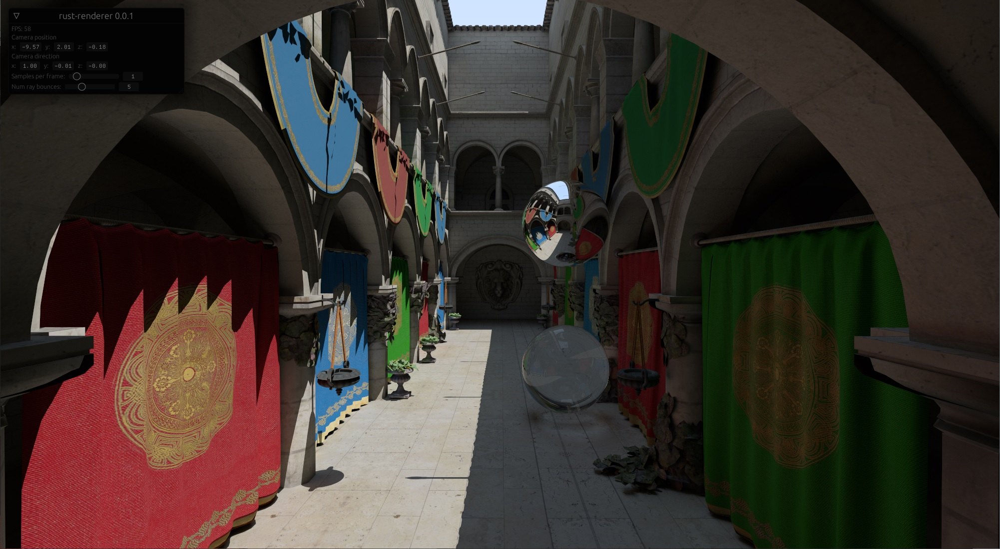
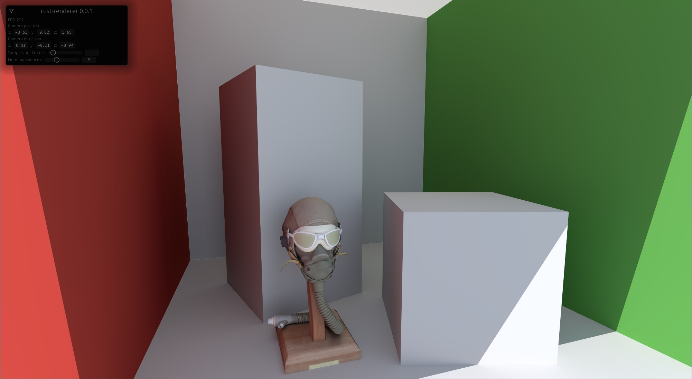

# rust-renderer



_Example renders using the path tracing mode_

Developed to learn Rust and to have a framework for experimenting with modern rendering techniques

## Features
+ GPU path tracer based on [Ray Tracing in One Weekend](https://raytracing.github.io/books/RayTracingInOneWeekend.html)
+ ReSTIR to improve sampling of analytical point lights
+ Basic PBR rendering
+ Bindless GPU resources
+ Experimental high level render graph
+ Vulkan using [ash](https://github.com/MaikKlein/ash)
+ SSAO, FXAA, IBL, shadow mapping
+ Raytraced shadows and reflections
+ Live shader recompilation
+ Shader reflection
+ Marching cubes demo

## Building

You need [Rust](https://www.rust-lang.org/tools/install) for building

Build and run the project with `cargo run --release`

**Note**: the ray tracing modes require a GPU with hardware ray tracing support, e.g. the
Nvidia RTX series. The rasterized modes run without it.

## Controls

- `1`, `2` - toggle between path tracing and rasterization
- `W/A/S/D` - move the camera
- `MOUSE + RMB` - rotate the camera
- `Q` - toggle profiling window
- `SPACE` - pause profiler

## Running on macOS (Apple Silicon) via KosmicKrisp

There is no native Metal backend; instead the Vulkan renderer runs on Apple GPUs through
[KosmicKrisp](https://docs.mesa3d.org/drivers/kosmickrisp.html), Mesa's Vulkan-on-Metal
driver. Requires **macOS 26+** and Xcode command line tools.

KosmicKrisp does not implement ray tracing, so the path tracing and RT passes are
unavailable — the app automatically starts in a rasterized mode. The rasterized,
minimal and shadertoy render graphs are supported.

### 1. Install dependencies (Homebrew)

```sh
# Build + runtime for the renderer
brew install cmake vulkan-loader vulkan-headers shaderc
# Build dependencies for KosmicKrisp / Mesa
brew install meson ninja pkg-config libclc llvm spirv-llvm-translator spirv-tools
```

### 2. Build the KosmicKrisp driver from Mesa

```sh
# Python build deps in a venv (recommended)
python3 -m venv ~/venv_mesa
source ~/venv_mesa/bin/activate
pip install mako packaging pyyaml "meson>=1.9.1"

git clone --depth=1 https://gitlab.freedesktop.org/mesa/mesa.git ~/git/mesa
cd ~/git/mesa
export PATH="/opt/homebrew/opt/llvm/bin:$PATH"
export PKG_CONFIG_PATH="/opt/homebrew/opt/spirv-tools/lib/pkgconfig:/opt/homebrew/opt/spirv-llvm-translator/lib/pkgconfig:/opt/homebrew/opt/libclc/share/pkgconfig:/opt/homebrew/lib/pkgconfig:/opt/homebrew/share/pkgconfig"
meson setup builddir --buildtype=debug -Dplatforms=macos \
  -Dvulkan-drivers=kosmickrisp -Dgallium-drivers= -Dopengl=false \
  -Dzstd=disabled --prefer-static
ninja -C builddir
```

This produces the driver and an ICD manifest at
`builddir/src/kosmickrisp/vulkan/kosmickrisp_mesa_devenv_icd.aarch64.json`.

### 3. Run

`run_kosmickrisp.sh` points the Vulkan loader at the KosmicKrisp ICD and sets the
build-time library paths. It expects the Mesa build at `~/git/mesa/builddir` (override
with the `MESA_BUILD` environment variable):

```sh
./run_kosmickrisp.sh                         # uses ~/git/mesa/builddir
MESA_BUILD=/path/to/mesa/builddir ./run_kosmickrisp.sh
```

To enable the Khronos validation layer (`brew install vulkan-validationlayers`), the
layer library must be on the dyld search path:

```sh
DYLD_LIBRARY_PATH=/opt/homebrew/opt/vulkan-validationlayers/lib ./run_kosmickrisp.sh
```

